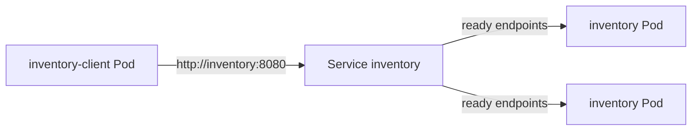

# Module 6: Service Discovery, Readiness, and Recovery

This lab deploys an Inventory application with two replicas and one client. The client calls Inventory only through the Kubernetes Service name `inventory`. The run below shows traffic reaching both replicas, one replica leaving rotation while it is still Running, that replica receiving traffic again after readiness returns, and Kubernetes replacing a deleted Pod without changing the Service name.

Captured on a kind cluster named `module6` (kind v0.33.0, node image `kindest/node:v1.37.0`) using Docker Desktop. Full terminal transcripts are in [`evidence/`](evidence/).

## Architecture

The client and both Inventory replicas run in the `module6` namespace. The client resolves the Service DNS name `inventory`. kube-proxy sends those requests only to Pods that are Ready.

```text
inventory-client (1 Pod)
        |
        |  http://inventory:8080/inventory
        v
Service "inventory"          ClusterIP, port 8080
selector: app=inventory      DNS name stays "inventory"
        |
        +----> inventory replica   Ready     receives traffic
        |
        +----> inventory replica   NotReady  stays Running, gets no Service traffic
```



## Application

Inventory is a small Python HTTP server.

| Path | Role |
| --- | --- |
| `GET /inventory` | Returns the catalog and the Pod name that served the request |
| `GET /ready` | Readiness probe. `200` when `/tmp/ready` exists, `503` when it does not |
| `GET /healthz` | Liveness probe. Always `200` while the process is up |

Liveness and readiness are separate on purpose. Removing `/tmp/ready` fails readiness and pulls the Pod out of the Service, and the liveness probe still succeeds, so Kubernetes leaves the container running.

A response from the Service looks like this:

```json
{"service": "inventory", "pod": "inventory-7648b58498-29dwz", "served": 43, "items": [{"sku": "SKU-1001", "name": "Wireless Mouse", "quantity": 42}, {"sku": "SKU-1002", "name": "Mechanical Keyboard", "quantity": 17}, {"sku": "SKU-1003", "name": "USB-C Hub", "quantity": 8}]}
```

The client is a loop. Its URL is the Service name, set in `k8s/client-deployment.yaml`:

```yaml
env:
  - name: INVENTORY_URL
    value: http://inventory:8080/inventory
```

Inside the namespace that name resolves to `inventory.module6.svc.cluster.local`.

## Prerequisites

- Docker
- kubectl
- One of: [kind](https://kind.sigs.k8s.io/), minikube, or Docker Desktop Kubernetes

## Deploy

Create a cluster if you do not already have one:

```bash
kind create cluster --name module6
```

From the repository root:

```bash
chmod +x scripts/*.sh
./scripts/deploy.sh
```

`scripts/deploy.sh` builds `inventory:1.0` and `inventory-client:1.0`, loads them into kind or minikube when that is the current context, and applies everything under `k8s/`. The Inventory Deployment requests 2 replicas. The Service name is `inventory`. The client Deployment requests 1 replica.

Check the workloads:

```bash
kubectl get pods,svc -n module6 -o wide
kubectl logs -n module6 deployment/inventory-client --tail=20
```

To repeat the three demonstrations and refresh the files in `evidence/`:

```bash
./scripts/collect-evidence.sh
```

Remove the lab:

```bash
./scripts/teardown.sh
```

### Manual readiness and recovery steps

Pick one Inventory Pod and remove its ready file. The readiness probe fails, and the Pod stays Running because `/healthz` still returns 200.

```bash
POD=$(kubectl get pods -n module6 -l app=inventory -o jsonpath='{.items[0].metadata.name}')
kubectl exec -n module6 "$POD" -- python -c "import os; os.path.exists('/tmp/ready') and os.remove('/tmp/ready')"
kubectl get pods -n module6 -l app=inventory
kubectl get endpoints inventory -n module6 -o yaml
```

Put the Pod back in rotation:

```bash
kubectl exec -n module6 "$POD" -- python -c "open('/tmp/ready','a').close()"
```

Delete a Pod and watch the Deployment create a replacement. The Service object is not changed.

```bash
kubectl delete pod -n module6 "$POD"
kubectl get pods -n module6 -o wide
kubectl get svc inventory -n module6
kubectl logs -n module6 deployment/inventory-client --tail=20
```

## 1. Both replicas and Service discovery

Both Inventory Pods were Running and Ready. The Service name is `inventory`, ClusterIP `10.96.237.6`, port 8080. From [`evidence/01-pods-and-service.txt`](evidence/01-pods-and-service.txt):

```text
$ kubectl get pods,svc -n module6 -o wide
NAME                                    READY   STATUS    RESTARTS   AGE   IP           NODE                    NOMINATED NODE   READINESS GATES
pod/inventory-7648b58498-qrd66          1/1     Running   0          14s   10.244.0.7   module6-control-plane   <none>           <none>
pod/inventory-7648b58498-w9kqg          1/1     Running   0          14s   10.244.0.3   module6-control-plane   <none>           <none>
pod/inventory-client-7bc75b5657-2pw7l   1/1     Running   0          14s   10.244.0.4   module6-control-plane   <none>           <none>

NAME                TYPE        CLUSTER-IP    EXTERNAL-IP   PORT(S)    AGE   SELECTOR
service/inventory   ClusterIP   10.96.237.6   <none>        8080/TCP   14s   app=inventory
```

The client log shows it calling `http://inventory:8080/inventory`, and the responses come from both Pod names. From [`evidence/02-client-log.txt`](evidence/02-client-log.txt):

```text
client starting; inventory service url=http://inventory:8080/inventory
2026-11-03T03:09:33Z OK via http://inventory:8080/inventory -> pod=inventory-7648b58498-w9kqg served=1 status=200
2026-11-03T03:09:34Z OK via http://inventory:8080/inventory -> pod=inventory-7648b58498-w9kqg served=2 status=200
2026-11-03T03:09:35Z OK via http://inventory:8080/inventory -> pod=inventory-7648b58498-w9kqg served=3 status=200
2026-11-03T03:09:36Z OK via http://inventory:8080/inventory -> pod=inventory-7648b58498-qrd66 served=1 status=200
2026-11-03T03:09:37Z OK via http://inventory:8080/inventory -> pod=inventory-7648b58498-qrd66 served=2 status=200
2026-11-03T03:09:38Z OK via http://inventory:8080/inventory -> pod=inventory-7648b58498-w9kqg served=4 status=200
2026-11-03T03:09:39Z OK via http://inventory:8080/inventory -> pod=inventory-7648b58498-w9kqg served=5 status=200
2026-11-03T03:09:40Z OK via http://inventory:8080/inventory -> pod=inventory-7648b58498-w9kqg served=6 status=200
2026-11-03T03:09:41Z OK via http://inventory:8080/inventory -> pod=inventory-7648b58498-w9kqg served=7 status=200
2026-11-03T03:09:42Z OK via http://inventory:8080/inventory -> pod=inventory-7648b58498-qrd66 served=3 status=200
2026-11-03T03:09:43Z OK via http://inventory:8080/inventory -> pod=inventory-7648b58498-w9kqg served=8 status=200
2026-11-03T03:09:44Z OK via http://inventory:8080/inventory -> pod=inventory-7648b58498-w9kqg served=9 status=200
2026-11-03T03:09:45Z OK via http://inventory:8080/inventory -> pod=inventory-7648b58498-qrd66 served=4 status=200
```

A 30-request burst from inside the client Pod, still using the Service URL, reached both replicas: 10 requests to `inventory-7648b58498-qrd66` and 20 to `inventory-7648b58498-w9kqg`. Full line-by-line output is in [`evidence/03-burst-both-replicas.txt`](evidence/03-burst-both-replicas.txt).

```text
--- replica counts ---
inventory-7648b58498-qrd66: 10
inventory-7648b58498-w9kqg: 20
```

## 2. Readiness failure and recovery

`/tmp/ready` was removed on `inventory-7648b58498-qrd66`. `inventory-7648b58498-w9kqg` was left ready.

The unready Pod was still Running, with zero restarts. Its container ready flag flipped to false. From [`evidence/05-readiness-failed-pods.txt`](evidence/05-readiness-failed-pods.txt):

```text
NAME                         PHASE     READY   RESTARTS   IP
inventory-7648b58498-qrd66   Running   false   0          10.244.0.7
inventory-7648b58498-w9kqg   Running   true    0          10.244.0.3
```

The Service endpoints moved that Pod from `addresses` to `notReadyAddresses`, so normal Service traffic no longer selects it. From [`evidence/06-readiness-failed-endpoints.txt`](evidence/06-readiness-failed-endpoints.txt):

```yaml
subsets:
- addresses:
  - ip: 10.244.0.3
    nodeName: module6-control-plane
    targetRef:
      kind: Pod
      name: inventory-7648b58498-w9kqg
      namespace: module6
      uid: 63fc9346-c94f-44c6-a59c-063dcccc62b5
  notReadyAddresses:
  - ip: 10.244.0.7
    nodeName: module6-control-plane
    targetRef:
      kind: Pod
      name: inventory-7648b58498-qrd66
      namespace: module6
      uid: 8fc6fa25-b435-4e61-b150-ce478d22e2c3
  ports:
  - name: http
    port: 8080
    protocol: TCP
```

The next 16 requests through `http://inventory:8080/inventory` all landed on the ready Pod. The unready Pod received none. From [`evidence/07-client-during-readiness-failure.txt`](evidence/07-client-during-readiness-failure.txt):

```text
--- replica counts while one pod is unready ---
inventory-7648b58498-w9kqg: 16
```

After `/tmp/ready` was restored, both Pods were Running and Ready again, and neither container restarted. From [`evidence/08-readiness-restored-pods.txt`](evidence/08-readiness-restored-pods.txt):

```text
NAME                         PHASE     READY   RESTARTS   IP
inventory-7648b58498-qrd66   Running   true    0          10.244.0.7
inventory-7648b58498-w9kqg   Running   true    0          10.244.0.3
```

A new 30-request burst was split evenly, 15 and 15, including the Pod that had been unready. Full output is in [`evidence/09-client-after-readiness-restored.txt`](evidence/09-client-after-readiness-restored.txt).

```text
--- replica counts after readiness restored ---
inventory-7648b58498-qrd66: 15
inventory-7648b58498-w9kqg: 15
```

## 3. Pod deletion and replacement

`inventory-7648b58498-qrd66` was deleted. From [`evidence/10-pod-deleted.txt`](evidence/10-pod-deleted.txt):

```text
$ kubectl delete pod -n module6 inventory-7648b58498-qrd66
pod "inventory-7648b58498-qrd66" deleted from module6 namespace
```

Kubernetes created `inventory-7648b58498-29dwz` at a new IP (`10.244.0.8`). The surviving replica `inventory-7648b58498-w9kqg` kept its name. The Service was still named `inventory`, with the same ClusterIP `10.96.237.6`. From [`evidence/11-replacement-pod-and-service.txt`](evidence/11-replacement-pod-and-service.txt):

```text
deleted pod: inventory-7648b58498-qrd66

$ kubectl get pods -n module6 -o wide
NAME                                READY   STATUS    RESTARTS   AGE   IP           NODE                    NOMINATED NODE   READINESS GATES
inventory-7648b58498-29dwz          1/1     Running   0          31s   10.244.0.8   module6-control-plane   <none>           <none>
inventory-7648b58498-w9kqg          1/1     Running   0          91s   10.244.0.3   module6-control-plane   <none>           <none>
inventory-client-7bc75b5657-2pw7l   1/1     Running   0          91s   10.244.0.4   module6-control-plane   <none>           <none>

$ kubectl get svc inventory -n module6
NAME        TYPE        CLUSTER-IP    EXTERNAL-IP   PORT(S)    AGE
inventory   ClusterIP   10.96.237.6   <none>        8080/TCP   91s
```

The client kept using `http://inventory:8080/inventory` and received answers from the surviving Pod and from the new Pod. From [`evidence/12-client-after-pod-replacement.txt`](evidence/12-client-after-pod-replacement.txt):

```text
2026-11-03T03:10:31Z OK via http://inventory:8080/inventory -> pod=inventory-7648b58498-w9kqg served=89 status=200
2026-11-03T03:10:32Z OK via http://inventory:8080/inventory -> pod=inventory-7648b58498-w9kqg served=90 status=200
2026-11-03T03:10:33Z OK via http://inventory:8080/inventory -> pod=inventory-7648b58498-29dwz served=3 status=200
2026-11-03T03:10:34Z OK via http://inventory:8080/inventory -> pod=inventory-7648b58498-w9kqg served=91 status=200
2026-11-03T03:10:35Z OK via http://inventory:8080/inventory -> pod=inventory-7648b58498-w9kqg served=92 status=200
2026-11-03T03:10:36Z OK via http://inventory:8080/inventory -> pod=inventory-7648b58498-w9kqg served=93 status=200
2026-11-03T03:10:37Z OK via http://inventory:8080/inventory -> pod=inventory-7648b58498-29dwz served=4 status=200
```

## Reflection

A stable Service name is useful because Pods are replaceable. When a Pod fails readiness or is deleted, Kubernetes gives the replacement a new name and a new IP, so a client that had saved a Pod address would break. The Service keeps one DNS name, `inventory`, and a stable ClusterIP, and it updates its endpoints to include only Pods that are Ready. In this lab the client never changed `http://inventory:8080/inventory`: traffic skipped `inventory-7648b58498-qrd66` while that Pod was unready, returned to it after readiness recovered, and later reached the replacement Pod `inventory-7648b58498-29dwz` after the original Pod was deleted. Callers can depend on the Service name instead of on any single Pod.

## Layout

```text
inventory/                 Inventory server and image
client/                    Client loop, burst helper, and image
k8s/                       Namespace, Deployment, Service, and client Deployment
scripts/deploy.sh          Build, load, and apply
scripts/collect-evidence.sh
scripts/teardown.sh
evidence/                  Terminal output from the kind run
```
